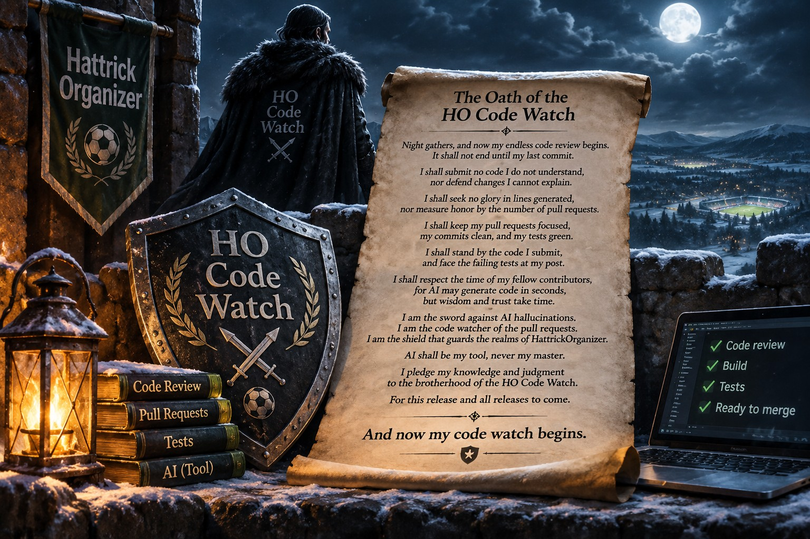

Then kneel, repeat after me, and take the oath of the HO Code Watch! ⚔️

# The Oath of the HO Code Watch

Night gathers, and now my endless code review begins.  
It shall not end until my last commit.

I shall submit no code I do not understand,  
nor defend changes I cannot explain.

I shall seek no glory in lines generated,  
nor measure honor by the number of pull requests.

I shall keep my pull requests focused,  
my commits clean,  
and my tests green.

I shall stand by the code I submit,  
and face the failing tests at my post.

I shall respect the time of my fellow contributors,  
for AI may generate code in seconds,  
but wisdom and trust take time.

I am the sword against AI hallucinations.  
I am the code watcher of the pull requests.  
I am the shield that guards the realms of HattrickOrganizer.

AI shall be my tool, never my master.

I pledge my knowledge and judgment  
to the brotherhood of the HO Code Watch.

For this release and all releases to come.

**And now my code watch begins.** 🛡️
